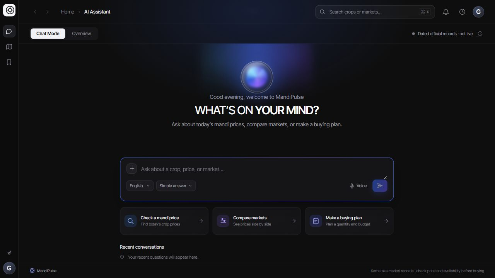
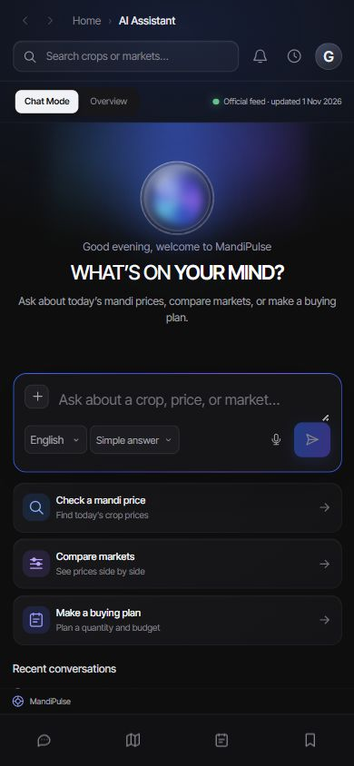

<div align="center">
  <h1>🌾 MandiPulse</h1>
  <p>
    <strong>Official mandi records. Clearer buying decisions.</strong>
    <br />
    A Karnataka market assistant for comparing prices, planning stock and understanding your buying costs.
  </p>
  <p>
    <a href="https://mandipulse-rosy.vercel.app/">🌐 Live Demo</a>
    ·
    <a href="https://github.com/harshithreddy1903-cmyk/MandiPulse/issues">Report Bug</a>
    ·
    <a href="https://github.com/harshithreddy1903-cmyk/MandiPulse/issues">Request Feature</a>
    ·
    <a href="USER_GUIDE.md">User Guide</a>
  </p>
  <p>
    
    
    
    
    
    
  </p>
</div>



<details>
  <summary>📱 View the mobile interface</summary>
  <p align="center">
    <br />
    
  </p>
</details>

---

## 🌟 About The Project

**MandiPulse** brings dated Karnataka mandi-price records into a practical buying workflow. Ask a question, compare the matching records, enter a quantity and transport estimate, then review a plan with its assumptions visible.

The app is open to guests: **questions, comparisons, buying plans and optional PDF downloads do not require an account**. Supabase sign-in adds a personal workspace for saved plans and conversations.

> Prices are wholesale observations, not supplier quotes or confirmation of current stock. Dated fallback records are clearly marked **not live**. Always check the price date, product form, quality and actual transport charges before buying.

## ✨ Feature Highlights

| Feature | What you can do |
| --- | --- |
| 💬 **Ask in plain language** | Ask about crops, prices and markets in English or Kannada. Optional AI supports general explanations; direct record-based comparisons and calculations do not need an AI response. |
| 📊 **Compare official records** | Review market, district, price date, wholesale price and variety/grade when supplied. Pulse comparisons distinguish whole pulses from processed dal. |
| 🧺 **Prepare buying plans** | Plan a single crop or an available vegetable/pulse starter mix using kilograms, quintals or metric tonnes, with an optional budget and freight rate. |
| 🔎 **Search the official catalog** | Choose an official product name and check its prices on demand. Catalog membership does not guarantee a matching Karnataka price record. |
| 📄 **Download an optional PDF** | Export crop weights, estimated costs, market details, dates and buying notes. Download as a guest or reopen a saved plan later. |
| 🔐 **Save your workspace** | Use optional Supabase Auth and user-owned database records to save plans and conversations. Guest chats remain on the current page only. |
| 🔔 **Set device price alerts** | Check live observations about every five minutes while the page is open and visible. Alerts do not trigger from cached prices. |
| 🕒 **See data boundaries** | Read live/dated labels, coverage warnings and history limitations alongside the result. Voice input and read-aloud depend on browser support. |

## 🧭 From Question to Buying Plan

1. **Ask or search** for a crop, market or comparison.
2. **Inspect the records**: product form, variety/grade, location and observation date matter.
3. **Enter your assumptions**: quantity, optional budget, destination and freight per quintal.
4. **Review the estimate**: compare market costs or inspect every crop's weight and cost in a mixed plan.
5. **Keep a copy**: accept the optional PDF offer, download later, or sign in to save the plan.

### 🧮 Transparent Buying Math

```text
1 quintal = 100 kg
1 metric tonne = 10 quintals

Estimated delivered price / quintal = modal price + entered freight / quintal
Single-crop estimate = estimated delivered price × quantity in quintals
Mixed-plan estimate = sum of the displayed per-crop estimated costs
```

Freight is included only when you supply a rate. Otherwise, costs are wholesale estimates before transport. Mixed plans show individual weights and rounded costs; their initial split is a trial stock mix, not a prediction of customer demand. Confirm loading, delivery charges and availability separately.

## 📡 Genuine Sources, Honest Coverage

- **Primary source:** the Government of India's data.gov.in AGMARKNET feed. Crops, markets and districts depend on the records actually returned; coverage is not fixed.
- **Dated fallback:** public official AGMARKNET weekly reports from selected Bengaluru markets, or a validated recent official snapshot. These results retain their actual dates, retrieval information and coverage warning. They cannot establish the cheapest price across Karnataka.
- **Date-aware answers:** a targeted answer can use dated records even when Overview has live data. Older records are not presented as today's prices when a request explicitly requires today or a particular date.
- **Catalog versus coverage:** the planning catalog can contain more products than the current price feed. Overview counts describe actual priced records, not every catalog entry.
- **History limits:** seven-day movement and any baseline estimate need sufficient comparable history. Missing history is shown explicitly; no forecast accuracy or future price is guaranteed.

The application uses real official observations for market results. Automated tests use synthetic fixtures. Detailed source behavior and operating limits are documented in [Setup & Operations](docs/SETUP.md#what-the-data-can-tell-you).

## 🛠️ Tech Stack

| Layer | Technology | Purpose |
| --- | --- | --- |
| Interface | React 18, JavaScript, Vite, CSS | Responsive chat, comparisons, planning and saved workspace |
| API | Python, FastAPI, Pydantic, HTTPX | Record retrieval, validation, routing and cost calculations |
| Reports | jsPDF | Optional buying-plan PDFs with wrapped text and pagination |
| Accounts | Supabase Auth and PostgreSQL RLS | Optional sign-in and user-owned saved records |
| AI | Optional Gemini API | General answers and explanations with server-held credentials |
| Hosting | Vercel static assets and Python Functions | Website and API under the same origin |

## 📂 Project Structure

```text
MandiPulse/
├── frontend/
│   ├── index.html
│   └── src/
│       ├── App.jsx                 # Chat, comparisons and planning interface
│       ├── components/             # Shared interface components
│       └── lib/                    # API, account, plan and PDF helpers + tests
├── backend/
│   ├── app/                       # FastAPI, official sources, cache and analytics
│   └── tests/                     # Backend regression tests
├── api/index.py                   # Vercel Python entry point
├── supabase/migrations/            # User-owned tables, RLS and quantity precision
├── docs/
│   ├── SETUP.md                   # Full configuration and operating guide
│   └── images/                    # Desktop and mobile interface previews
├── USER_GUIDE.md                   # Plain-language walkthrough
├── VERIFICATION.md                 # Dated verification evidence and remaining limits
├── start.cmd / start.ps1           # Windows local launcher
├── vercel.json                    # Production routing and build configuration
└── .env.example                   # Configuration template, without real credentials
```

## 🚀 Getting Started

### Prerequisites

- Python **3.10+** for local development. The Vercel deployment selects Python 3.12.
- Node.js **20.19+ in the 20.x line, or 22.12+**, with npm.
- Windows PowerShell for the included launcher. Manual API startup is covered in the full setup guide.

### Quick Setup on Windows

```powershell
git clone https://github.com/harshithreddy1903-cmyk/MandiPulse.git
cd MandiPulse
npm ci
py -m venv .venv
.\.venv\Scripts\python.exe -m pip install -r backend\requirements.txt
Copy-Item .env.example .env
```

Create `.env` only on a fresh checkout; preserve an existing file. Configure the official feed settings there. Add Gemini settings for optional AI explanations and Supabase settings only if you want account saving. The [full setup guide](docs/SETUP.md#first-time-setup-on-windows) explains each variable and the two account migrations.

Then start both local services:

```powershell
.\start.cmd -OpenBrowser
```

The website opens at **http://127.0.0.1:5175**, with the API on port **8000**. Repeating the launcher reuses healthy servers belonging to this exact project and refuses unrelated port owners. See [launcher and restart details](docs/SETUP.md#start-mandipulse).

> 🔐 Keep `.env` private. AI/data-provider secrets belong on the backend, never in `VITE_` variables. Supabase browser settings use the publishable key with row-level security; no service-role secret belongs in the browser.

## ✅ Tests & Verification

**Verification snapshot — 1 November 2026:** **203 automated tests passed: 165 backend + 38 frontend**, along with the production frontend build.

```powershell
npm run test:frontend
npm run test:backend
npm run build
```

The suites cover routing, source fallbacks, quantities, product forms, saved-plan snapshots, API error states, cost calculations and PDF pagination/rounding. They use fixtures and do not replace live provider or account checks. See [VERIFICATION.md](VERIFICATION.md) for dated browser/deployment evidence and checks that remain outside the automated suites.

## ☁️ Deployment & Operating Limits

The [live app](https://mandipulse-rosy.vercel.app/) hosts the Vite frontend and FastAPI routes together on Vercel. Production uses the same-origin API by default and ignores localhost API addresses. Vercel/provider configuration is explained in [Setup & Operations](docs/SETUP.md#vercel-deployment).

Market-data coverage, provider quotas and AI availability can change. Vercel caches and in-memory rate limits are temporary and are not shared across all function instances. Price alerts stop checking when the page is closed; they are not a background notification service. Account saving needs Supabase configuration and migrations. Read the [user guide](USER_GUIDE.md) before relying on any buying estimate.

## 📬 Contact & Feedback

**Harshith Reddy K M** · [GitHub profile](https://github.com/harshithreddy1903-cmyk)

Found a problem or have an idea? [Open an issue](https://github.com/harshithreddy1903-cmyk/MandiPulse/issues) with the steps to reproduce it and the observed behavior. Please omit credentials and personal account details.
